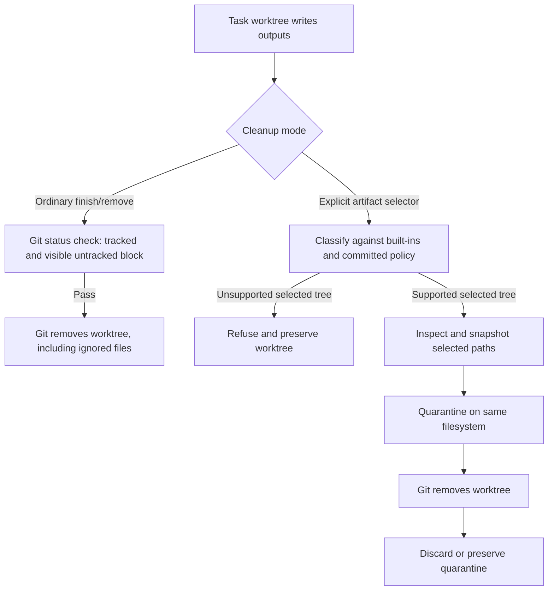

# Worktree Artifact Lifecycle: Design Review and Roadmap

Status: historical design review; default cleanup policy updated on 2026-10-23.

Review date: 2026-10-23.

## Scope

This review covers opt-in artifact classification, repository artifact policy, tree inspection, quarantine and purge, and their interaction with the `finish` lifecycle.

It also covers the contract between `wtctl` and package-manager build/test commands that create ignored output inside task worktrees.

Ordinary `finish` and `remove` now follow Git's default worktree-removal behavior: tracked changes and non-ignored untracked files block removal, while ignored files are removed with the worktree.

The recommendations below apply only when an explicit artifact selector requests quarantine or preservation; they do not define ordinary cleanup behavior.

## Summary

Explicit artifact handling has a sound fail-closed shape: `wtctl` classifies selected outputs, snapshots them, quarantines them on the same filesystem, and refuses the selected operation if state is not understood.

The main design gap is that the policy model is narrower than common nested package-manager output layouts.

The repository configuration can name exact regular files, while built-in policy recognizes only a small set of cache-directory names and build-output roots.

A SwiftPM task can produce a nested `.build` tree containing internal symlinks and dependency checkouts, plus a separately configured cache directory, and both can remain unknown to `finish`.

Adding `.build` to a directory-name list alone would not complete the fix because the generic tree signer rejects nested symlinks and nested Git repositories.

The second major gap is resource bounds: artifact manifests are written from the full tree snapshot without the size limit enforced by manifest readers.

## Root cause

Artifact safety policy and Git ignore rules are intentionally separate, but there is no supported, exact policy for nested generated directory roots.

Package-manager wrappers can also direct dependency caches and build outputs to different locations, so configuring one path does not ensure that every generated path is classifiable by `wtctl`.

The resulting failure remains relevant to explicit quarantine and preservation, but it does not justify changing Git-compatible ordinary cleanup.

## Lifecycle model

The explicit-artifact safety boundary depends on recognizing a path before it is quarantined.

Git ignore status alone does not authorize quarantine or preservation.

For ordinary cleanup, Git ignore status determines whether a path blocks removal, matching `git worktree remove`.

## Verified design facts

`src/artifact_defaults.json` contains cache roots, cache directory names, build-output roots, and one marked generated configuration file.

`src/artifact.rs::generated_roots` recognizes a nested directory when its basename appears in `cache_directory_names`, while build-output roots are exact relative paths.

The current cache directory name set contains `__pycache__`, and the current build-output roots are `target`, `rust/target`, and `result`.

`src/artifact_config.rs::load` reads `.wtctl.json` from the committed `HEAD` of the main worktree so a task cannot authorize its own cleanup.

The schema-1 `generated_artifacts` field accepts exact repository-root regular-file paths and rejects directories, nested paths, globs, traversal, and unknown fields.

`src/artifact.rs::sign_tree` walks directory contents without following symlinks, refuses nested Git repositories and special files, and checks mount boundaries.

Generic directory-tree signatures record file identity and metadata; ordinary file contents are not hashed unless a specialized policy path requests a digest.

`src/artifact.rs::write_manifest` serializes the transaction manifest without a byte-size limit, while recovery and quarantine readers reject manifests larger than 64 MiB.

`src/artifact.rs::lsof_open_paths` batches path arguments by byte count, but a large tree still requires a full traversal and may launch many `lsof` processes.

`src/main.rs::integrate_task` preflights cleanup before integration, and `src/main.rs::cmd_finish` rechecks afterward.

If cleanup becomes invalid after integration, `cmd_finish` preserves the worktree and records a cleanup-pending audit event.

`src/finish_plan.rs` implements a non-mutating `finish --dry-run` in this source revision.

`wtctl capabilities --json` is the supported compatibility contract for optional lifecycle features.

`tests/cli.rs` covers root `target` cleanup, nested `__pycache__` classification, exact-file selectors, preservation, purge, rollback, and a cleanup race for a kept worktree.

The current test suite does not cover a nested SwiftPM build tree, nested package-cache roots, or a manifest crossing the reader size limit.

Relevant implementation and test sources are `src/artifact_defaults.json`, `src/artifact_config.rs`, `src/artifact.rs`, `src/finish_plan.rs`, `src/main.rs`, and `tests/cli.rs`.

## Findings

Priority definitions: P0 blocks an ordinary documented task workflow; P1 is an integrity or recovery risk under feasible edge conditions; P2 is a usability or maintenance gap.

| ID | Priority | Finding | Evidence and impact |
|---|---|---|---|
| A1 | P0 | Common nested build and package-cache directories are not covered by the artifact policy. | `artifact_defaults.json` has no SwiftPM build root or package-cache root, while `.wtctl.json` accepts only exact repository-root regular files and cannot declare directories; normal package validation can therefore block `finish`. |
| A2 | P0 | Adding a build-directory name alone is insufficient for SwiftPM-shaped trees. | The generic signer refuses nested symlinks and nested `.git` entries; SwiftPM output trees may contain both forms, so Phase 0 must reproduce the exact forms before a classifier change can be accepted. |
| A3 | P1 | Manifest write and recovery limits disagree. | The writer can serialize an unbounded tree snapshot, but recovery readers cap the manifest at 64 MiB; an interrupted large-tree quarantine could become unreadable to the recovery path. |
| A4 | P1 | Directory-tree change detection is metadata-based for most files. | Ordinary entries are checked by device, inode, mode, size, and mtime, while content digests are only recorded on specialized paths; same-metadata content rewrites are outside the current detection guarantee. |
| A5 | P2 | `finish` has a safe but easy-to-misread partial-success state. | A post-integration cleanup refusal leaves `main` integrated and the task worktree present; callers must distinguish this from a fully finished task and use the audit/list state to resume. |
| A6 | P2 | Package-manager output paths and `wtctl` artifact roots are not validated as one workflow. | Current tests exercise artifact primitives but do not run a nested package-manager build followed by `finish` preflight and cleanup. |
| A7 | P2 | Source and deployed capability sets can drift. | Capability probing lets callers fail closed, but downstream pins can still omit features present in a source checkout; release acceptance should compare the installed capability set with the documented one. |
| A8 | P2 | Artifact snapshot terminology can overstate the integrity guarantee. | “Signed” tree entries primarily snapshot filesystem metadata; the threat model and the content-hash boundary should be stated explicitly. |

## Intentional safeguards to preserve

Unknown ignored paths are removed by ordinary cleanup, matching Git; non-ignored untracked paths continue to block it.

Explicit artifact selection remains opt-in and retains its classification, signature, and quarantine checks.

Repository artifact policy must remain committed in `main`, not be supplied by the task being cleaned up.

Path patterns and broad `.gitignore` interpretation must not silently authorize deletion.

Nested Git metadata, symlinks, special files, mount points, and tracked descendants must remain explicit policy cases rather than being followed or discarded implicitly.

`--external-writers-quiesced` is an operator assertion, not a substitute for the integration lock or scheduled-writer inspection.

## Recommended direction

Keep ordinary cleanup aligned with Git's status-based refusal behavior rather than requiring artifact classification for ignored paths.

Keep quarantine and preservation opt-in; `.gitignore` status alone must not authorize moving a path into artifact quarantine.

Use built-in rules only for directory names that are broadly and predictably disposable across repositories.

Use exact, committed-main directory policy for nonstandard generated directories, and retain the exact-file selector for isolated one-off files.

For any supported directory root, define how nested symlinks, nested Git metadata, mount points, special files, tracked descendants, and large trees are handled before enabling cleanup.

Deploy and verify any new directory-policy capability before committing consumer configuration that uses it, because older binaries reject unknown `.wtctl.json` fields.

## Historical roadmap for explicit artifact handling

The following phases remain candidate work for explicit artifact handling only.

They are not prerequisites for ordinary Git-compatible `finish` or `remove`.

### Phase 0: Reproduce and define the supported tree shape

Add a consumer-neutral CLI fixture for a nested SwiftPM-style build output and a separately configured dependency cache.

Use fixtures for ordinary Git-compatible cleanup and explicit artifact selection, including an unknown sibling that must block the explicit quarantine operation.

Include internal and external symlink targets, dangling symlinks, nested `.git` directories and `.git` files, normal files, and tracked descendants.

Simulate an artifact-root or ancestor replacement between inspection and quarantine, and verify that no path outside the selected root is traversed or modified.

Record which forms are supported, which are refused, whether refusal occurs before or after `main` integration, and the exact task/worktree/quarantine state afterward.

### Phase 1: Bound tree inspection and recovery state

Add entry-count and path-byte bounds during traversal, before materializing an unbounded tree snapshot.

Choose one documented serialized-manifest byte limit and enforce it before quarantine.

Keep the writer and every recovery reader on the same boundary rule.

If the current manifest format cannot represent a supported tree within the bound, either refuse before mutation or use a bounded streaming/compact format.

Test serialized manifests below, at, and above the limit.

Decide and test whether ordinary files need content digests or whether metadata snapshots plus the external-writer contract are sufficient.

Do not enable new directory cleanup until these resource and recovery limits pass regression tests.

### Phase 2: Introduce an explicit directory-artifact contract

Evaluate a standard `.build` built-in against exact repository-declared directory roots for nonstandard generated paths.

Prefer exact, committed-main directory roots over globs or inference from `.gitignore`.

Require real directory ancestors and a real directory root, reject path traversal and symlinked ancestors, and refuse tracked descendants.

Recheck root identity and containment immediately before quarantine and verify the signed tree after the move.

Specify whether nested symlinks and nested Git metadata are refused or treated as opaque entries under an explicitly authorized directory root.

If nested symlinks are allowed, record and verify link text without traversing their targets.

Advertise directory-policy support as a capability in the candidate package.

Keep the artifact tree signer no-follow and preserve mount-point, special-file, and same-filesystem checks.

Do not release or deploy directory cleanup until the integration, recovery, and failure-path gates in Phases 3 and 4 pass.

### Phase 3: Connect real build workflows to the artifact contract

For each supported package-manager wrapper, set both the dependency-cache path and build-output path deliberately.

Keep outputs inside an exact declared artifact root or use a documented external task-scoped cache with its own lifecycle.

Add an end-to-end test against the candidate package that runs the wrapper, confirms the generated paths, checks `finish --dry-run` only when the candidate advertises it, then verifies actual finish and quarantine behavior.

Do not require consumers to infer that `--cache-path` also changes the separate build-output path.

### Phase 4: Clarify partial completion and operator diagnostics

Make dry-run output identify every selected artifact root, its classification rule, and any unsupported nested content.

Make an integrated-but-cleanup-pending result explicit in both text and JSON output, including the task id and recovery command.

Add separate regression tests for refusal before integration, which must leave `main` unchanged, and cleanup failure after integration, which must retain the integrated `main`, worktree, artifact data, and audit explanation.

Document that dry-run is a point-in-time preview and the real `finish` repeats checks under its lock.

### Phase 5: Align release and deployment contracts

Keep command documentation tied to the installed `capabilities` contract rather than assuming every source checkout has been deployed.

Add release checks that compare documented optional features with the capabilities of the packaged binary.

Release and deploy the wtctl feature only after all earlier phase gates pass.

For downstream Nix consumers, verify the pinned revision, build output, installed binary path, and capability JSON after deployment.

Only then commit downstream configuration that uses the new directory-policy field.

## Acceptance criteria

An unsupported path selected for explicit artifact handling before integration refuses that operation without changing `main`, task files, or quarantine state.

Ordinary cleanup permits ignored paths and refuses tracked changes or non-ignored untracked paths before `main` integration.

An artifact change discovered after integration leaves `main` integrated and preserves the worktree and data with an explicit cleanup-pending result.

Every supported generated directory is covered by either a committed built-in rule or an exact committed repository policy.

Directory cleanup either safely handles its documented symlink and nested-repository contents or refuses before moving anything.

The writer and every recovery reader apply the same serialized-manifest byte limit.

Tests at, below, and above that boundary produce the same accept/refuse result in write and recovery paths.

An over-limit tree is refused before artifact movement or an unrecoverable quarantine transaction.

Entry-count and path-byte limit tests also verify that refusal preserves all source artifacts.

The CLI test suite covers dry-run, actual finish, preservation, rollback, partial completion, and recovery for the supported nested build shape.

The installed capability JSON is checked before downstream workflows rely on optional finish behavior.

## Open decisions

For explicit artifact handling, should `.build` be a broadly recognized generated root, or should the consumer explicitly declare it in committed repository policy?

For explicit artifact handling, should nested Git directories and symlinks be allowed only inside a declared build root, or should package managers place those trees outside worktrees?

Should directory manifests hash every regular file, use a compact tree digest, or retain metadata snapshots with a documented trust boundary?

Should large artifact trees be rejected at a documented bound or supported through a streaming manifest format?
